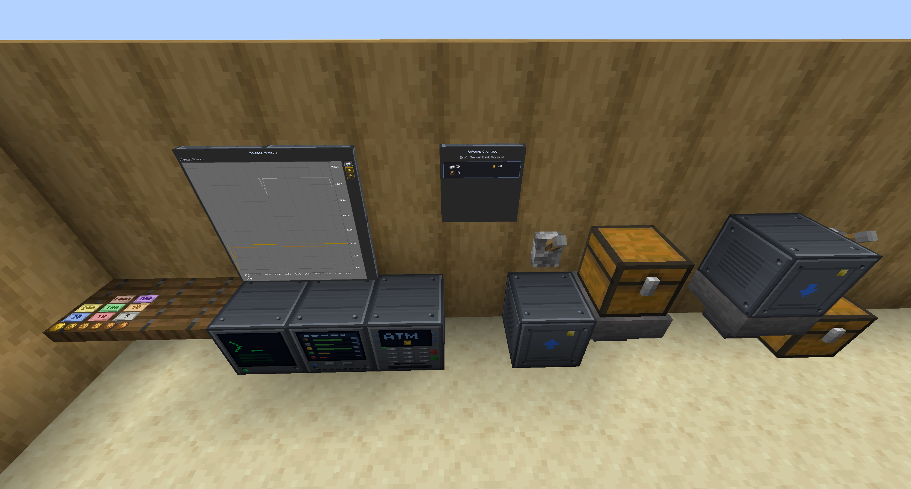

# BankSystem

    

BankSystem adds a full banking system to Minecraft: every player gets a bank account for money and items, with shared accounts, cash you can hold, redstone automation and companies that sell shares. Connect several servers and they share the same bank.

## Features

- A [bank account](https://kroia.github.io/BanksystemStockmarketDoku/banksystem/bank-accounts/) for every player, plus shared accounts with **Deposit**, **Withdraw** and **Manage** rights.
- Store items, not only money: the [Bank Terminal](https://kroia.github.io/BanksystemStockmarketDoku/banksystem/bank-terminal/) deposits, withdraws and even crafts from your bank.
- Cash you can hold: banknotes and coins from the [ATM](https://kroia.github.io/BanksystemStockmarketDoku/banksystem/money/), and a Money Stockpile to show them off.
- [Redstone automation](https://kroia.github.io/BanksystemStockmarketDoku/banksystem/automation/) with the Bank Upload Block and Bank Download Block.
- [Bank Displays](https://kroia.github.io/BanksystemStockmarketDoku/banksystem/displays/) show an account's balances or its history chart on a wall.
- [Companies](https://kroia.github.io/BanksystemStockmarketDoku/banksystem/companies/) with workers, wages, dividends and printed [shares](https://kroia.github.io/BanksystemStockmarketDoku/banksystem/shares/).
- Works with Create: Numismatics and Lightman's Currency through [currency bindings](https://kroia.github.io/BanksystemStockmarketDoku/banksystem/currency-bindings/).
- [Multi-server banking](https://kroia.github.io/BanksystemStockmarketDoku/admin/multi-server/): connected servers share one set of bank accounts.
- [Admin tools](https://kroia.github.io/BanksystemStockmarketDoku/admin/): a transaction history, audits, suspicious-activity alerts, frozen accounts and per-player limits.
- [Placeholders](https://kroia.github.io/BanksystemStockmarketDoku/admin/placeholders/) for TAB and Placeholder API, a [Discord feed](https://kroia.github.io/BanksystemStockmarketDoku/admin/discord/) of bank events and LuckPerms [permissions](https://kroia.github.io/BanksystemStockmarketDoku/admin/permissions/).
- An [API for mod authors](https://kroia.github.io/BanksystemStockmarketDoku/developers/) to read balances, pay players and add their own currency mod.

## Blocks and items

All recipes are on the [Blocks and recipes](https://kroia.github.io/BanksystemStockmarketDoku/banksystem/blocks-and-recipes/) page.

| Block | What it does |
|---|---|
| **Terminal Block** | An empty terminal. Program it with software. |
| **Bank Terminal Block** | Put items into the bank and take them out. |
| **ATM** | Take out cash and change notes. |
| **Bank Upload Block** | Sends items from hoppers into the bank. |
| **Bank Download Block** | Refills itself from the bank. |
| **Bank Display** | Shows an account on a wall. |
| **Share Stamper** | Makes company shares. |
| **Metal Case Block** | A part for the other blocks. |
| **Money Stockpile Block** | A pile of cash. You don't craft it: right-click a block with money. |

| Item | What it is for |
|---|---|
| **Circuit Board**, **Display** | Parts for blocks and modules. |
| **Empty Software** | The base for every software. |
| **Banking Software**, **ATM Software** | Program a Terminal Block. |
| **Bank Transmitter Module**, **Bank Receiver Module** | Parts for the Upload and Download Blocks. |
| **Blank Share**, **Company Share** | A share before and after the Share Stamper. |
| Money | Coins from **1 Cent** to **50 Cent** plus the **Dollar** coin, and banknotes from **5 Dollar** up to **1'000'000 Dollar**. |

## Supported versions

BankSystem needs [Architectury API](https://www.curseforge.com/minecraft/mc-mods/architectury-api), and on Fabric also [Fabric API](https://www.curseforge.com/minecraft/mc-mods/fabric-api). Downloads: [CurseForge](https://www.curseforge.com/minecraft/mc-mods/banksystem) · [Modrinth](https://modrinth.com/mod/kroia_banksystem)

| Minecraft | Fabric | NeoForge |
|---|---|---|
| 26.3 | [][2.2.0-fabric-26.3] | [][2.2.0-neoforge-26.3] |
| 26.2 | [][2.2.0-fabric-26.2] | [][2.2.0-neoforge-26.2] |
| 26.1 | [][2.2.0-fabric-26.1] | [][2.2.0-neoforge-26.1] |
| 1.21.11 | [][2.2.0-fabric-1.21.11] | [][2.2.0-neoforge-1.21.11] |
| 1.21.10 | [][2.2.0-fabric-1.21.10] | [][2.2.0-neoforge-1.21.10] |
| 1.21.9 | [][2.2.0-fabric-1.21.9] | [][2.2.0-neoforge-1.21.9] |
| 1.21.8 | [][2.2.0-fabric-1.21.8] | [][2.2.0-neoforge-1.21.8] |
| 1.21.7 | [][2.2.0-fabric-1.21.7] | [][2.2.0-neoforge-1.21.7] |
| 1.21.6 | [][2.2.0-fabric-1.21.6] | [][2.2.0-neoforge-1.21.6] |
| 1.21.5 | [][2.2.0-fabric-1.21.5] | [][2.2.0-neoforge-1.21.5] |
| 1.21.4 | [][2.2.0-fabric-1.21.4] | [][2.2.0-neoforge-1.21.4] |
| 1.21.3 | [][2.2.0-fabric-1.21.3] | [][2.2.0-neoforge-1.21.3] |
| 1.21.2 | [][2.2.0-fabric-1.21.2] | [][2.2.0-neoforge-1.21.2] |
| 1.21.1 | [][2.2.0-fabric-1.21.1] | [][2.2.0-neoforge-1.21.1] |

<!-- Links to CurseForge -->
[2.2.0-neoforge-1.21.1]:https://www.curseforge.com/minecraft/mc-mods/banksystem/files/9781819
[2.2.0-fabric-1.21.1]:https://www.curseforge.com/minecraft/mc-mods/banksystem/files/9781582
[2.2.0-neoforge-1.21.2]:https://www.curseforge.com/minecraft/mc-mods/banksystem/files/9781822
[2.2.0-fabric-1.21.2]:https://www.curseforge.com/minecraft/mc-mods/banksystem/files/9781821
[2.2.0-neoforge-1.21.3]:https://www.curseforge.com/minecraft/mc-mods/banksystem/files/9781827
[2.2.0-fabric-1.21.3]:https://www.curseforge.com/minecraft/mc-mods/banksystem/files/9781824
[2.2.0-neoforge-1.21.4]:https://www.curseforge.com/minecraft/mc-mods/banksystem/files/9781834
[2.2.0-fabric-1.21.4]:https://www.curseforge.com/minecraft/mc-mods/banksystem/files/9781833
[2.2.0-neoforge-1.21.5]:https://www.curseforge.com/minecraft/mc-mods/banksystem/files/9781839
[2.2.0-fabric-1.21.5]:https://www.curseforge.com/minecraft/mc-mods/banksystem/files/9781835
[2.2.0-neoforge-1.21.6]:https://www.curseforge.com/minecraft/mc-mods/banksystem/files/9781842
[2.2.0-fabric-1.21.6]:https://www.curseforge.com/minecraft/mc-mods/banksystem/files/9781840
[2.2.0-neoforge-1.21.7]:https://www.curseforge.com/minecraft/mc-mods/banksystem/files/9781845
[2.2.0-fabric-1.21.7]:https://www.curseforge.com/minecraft/mc-mods/banksystem/files/9781843
[2.2.0-neoforge-1.21.8]:https://www.curseforge.com/minecraft/mc-mods/banksystem/files/9781848
[2.2.0-fabric-1.21.8]:https://www.curseforge.com/minecraft/mc-mods/banksystem/files/9781846
[2.2.0-neoforge-1.21.9]:https://www.curseforge.com/minecraft/mc-mods/banksystem/files/9781852
[2.2.0-fabric-1.21.9]:https://www.curseforge.com/minecraft/mc-mods/banksystem/files/9781850
[2.2.0-neoforge-1.21.10]:https://www.curseforge.com/minecraft/mc-mods/banksystem/files/9781858
[2.2.0-fabric-1.21.10]:https://www.curseforge.com/minecraft/mc-mods/banksystem/files/9781857
[2.2.0-neoforge-1.21.11]:https://www.curseforge.com/minecraft/mc-mods/banksystem/files/9781860
[2.2.0-fabric-1.21.11]:https://www.curseforge.com/minecraft/mc-mods/banksystem/files/9781859
[2.2.0-neoforge-26.1]:https://www.curseforge.com/minecraft/mc-mods/banksystem/files/9781863
[2.2.0-fabric-26.1]:https://www.curseforge.com/minecraft/mc-mods/banksystem/files/9781861
[2.2.0-neoforge-26.2]:https://www.curseforge.com/minecraft/mc-mods/banksystem/files/9781867
[2.2.0-fabric-26.2]:https://www.curseforge.com/minecraft/mc-mods/banksystem/files/9781864
[2.2.0-neoforge-26.3]:https://www.curseforge.com/minecraft/mc-mods/banksystem/files/9781870
[2.2.0-fabric-26.3]:https://www.curseforge.com/minecraft/mc-mods/banksystem/files/9781868
