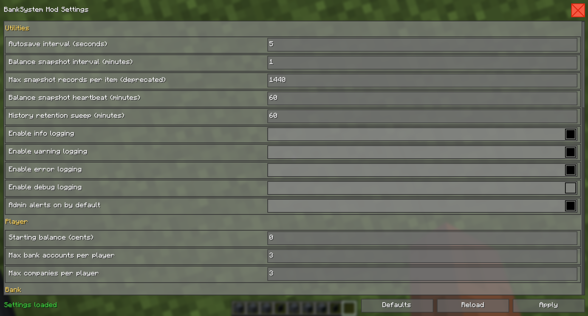
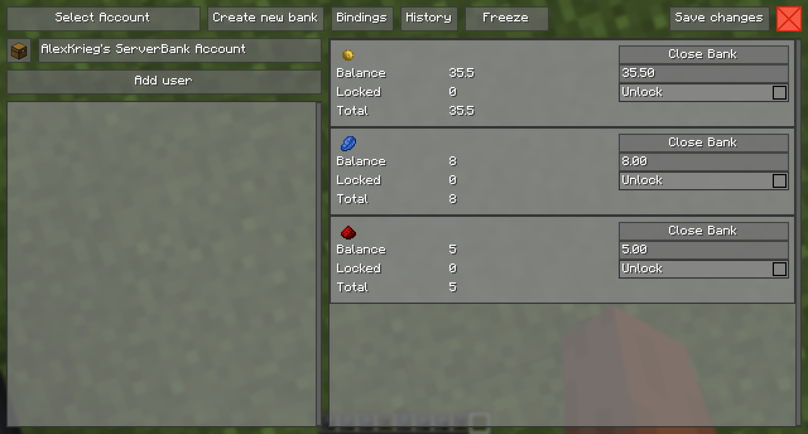

# Administration Guide

This guide is for server administrators and single-player worlds.

## Managing Banking Items

By default a new world can bank money, iron ingots, gold ingots, diamonds, emeralds and coal. To change which items can be used for banking, an admin can open the bankable-items management window:
```
/banksystem manage
```

<div align="center">
     
</div>
<br>

In this window you can add/remove items which can be stored in the bank.

- **Left side**: A list of all items that can be stored inside a bank. Click on an item to see details.
- **Right side**: Overview of the selected item showing the total supply (sum of all players' balances) and the total locked amount across all players.
- **Manage button**: Opens the [player account management](#managing-player-bank-accounts) window for the selected player.

Items can also be added/removed via commands:
```
/banksystem allowItem <itemID>
/banksystem allowItemInHand
/banksystem disallowItem <itemID>
/banksystem disallowItemInHand
```

> [!WARNING]
> Disallowing an item removes the item bank from **all** player accounts. This action cannot be undone.

> [!NOTE]
> The bank tells items apart by their data (enchantments, names, …), so every new variant gets its own internal id. To stop a player from filling the item registry, each player can create at most **256 new item variants per server run**. Plain items without extra data do not count, and BankSystem admins and other mods are not limited. When a player reaches the limit, the server log says so once, and further new variants from that player are not registered until the next restart.

---
## Managing Player Bank Accounts

To manage a specific player's bank account, use one of the following methods:

- Command: `/bank <player_name> manage`
- Click the **Manage** button in the [settings GUI](#managing-banking-items).
- Right-click on a player with the **Banking Software** item. This needs creative mode, the permission `banksystem.admin.software` (operator level 2 without a permission mod) and the BankSystem admin flag.

<div align="center">
     
</div>
<br>

The window shows all items currently stored in the player's bank account.

<details>
<summary><b>Add new item</b></summary>
Click on the <b>Create new bank</b> button and select the item you want to add to the player's account.<br>
The item bank will be created instantly, no need to press the save button.
</details>

<details>
<summary><b>Remove an item</b></summary>
If you want to delete an item from the user's bank, click on <b>Close account</b>. A deleted account is marked red.<br>
Click the <b>Save changes</b> button to apply your changes.
</details>

<details>
<summary><b>Change balance</b></summary>
Change the balance of a specific item using the text field.<br>
Click the <b>Save changes</b> button to apply your changes.
</details>

<details>
<summary><b>Freeze account</b></summary>
Click <b>Freeze</b> in the header row (it reads <b>Unfreeze</b> while the account is frozen; a <b>*</b> marks an unsaved change), then <b>Save changes</b>. The same works with <code>/banksystem freeze &lt;account&gt; [on|off]</code> (BankSystem admins, or the master server console).<br>
A frozen account refuses every player action that moves money or items in or out: terminal deposits and withdrawals, bank notes, the converter, Bank Upload/Download blocks, crafting with bank items, money transfers to or from it, and payouts/dividends paid from it (the payout history shows <i>Account frozen</i>). The player gets a chat message and keeps their items. Members still see the account (a grey <b>Frozen</b> marker), but only admins can close its banks.<br>
Admin edits keep working, and so does StockMarket's settlement (unlocking and paying out existing orders). Every freeze and unfreeze is recorded in the <a href="#transaction-ledger">transaction ledger</a> (code 26) with the admin or console as actor. On an untrusted slave server the button is greyed out like the other admin edits.
</details>

<details>
<summary><b>Release locked amount</b></summary>
Check the checkbox if you want to release the locked amount for a specific item. This may affect other mods which have locked the money/item in the first place.<br>
Click the <b>Save changes</b> button to apply your changes.
</details>

---
## Locked Amounts

A locked amount is part of a balance that is reserved and cannot be spent. Two things lock amounts:

- **Other mods.** The [Stock Market Mod](https://github.com/KROIA/StockMarket) for example reserves the money or items for pending trades. If a trade is not executed immediately, the player must wait until it is processed. To prevent double spending during this time, the amount is locked.
- **BankSystem itself.** A Bank Download Block, a Bank Terminal withdrawal or crafting with bank items first locks the amount and then withdraws it. If the withdrawal fails in a way where BankSystem cannot tell whether the master server took the items (on a [multi-server network](MultiserverSetup.md#reliability-when-the-master-does-not-answer), or when the server stops mid-craft), or the player already took the items out, the amount **stays locked** instead of being released. Releasing it blindly could hand the same value out twice.

Before you press **Unlock**, find out where the locked amount came from:

1. Open `/banksystem audit <player|account>` and look at the entries around the time the amount got locked. A withdrawal entry (`WITHDRAW`, `DOWNLOAD_WITHDRAW`, `CRAFT_CONSUME`) for the same amount means the items were delivered and paid for, and the lock is a leftover that is safe to release only if no mod still needs it.
2. Check the server log for lines with `left locked for the admin`, `Un-debited craft` or `unknown outcome`. They name the account, the item, the amount and the transfer ID.
3. On a multi-server network, look up that transfer ID in the slave's diagnostics database (`TransferJournal` table, see [Backups](#backups)). A `CONFIRMED` or `DELIVERED` step means the master applied it.
4. If StockMarket is installed, check the player's open orders. Their reserved amounts are locked too.

> [!CAUTION]
> Releasing locked amounts without knowing who reserved them may cause problems with pending transactions in other mods, or give a player items twice.

---
## Server Settings File

BankSystem stores its per-world server configuration in `<world>/data/BankSystem/settings.json` (auto-save interval, balance-history snapshots, starting balance, automation block intervals, and the item component lists described below).

See the [Configuration guide](Configuration.md) for the full annotated reference of every setting, including when the file is created and rewritten by the server.

---
## Backups

BankSystem keeps its balance history and transaction ledger in a SQLite database (`banksystem.db`) written by a background worker, so a plain file copy taken while the server runs can catch it mid-write. Four op-only commands make an external backup safe (master server only):

| Command | What it does |
|---------|--------------|
| `/banksystem backup snapshot <path>` | Writes a consistent copy of the database to `<path>` using SQLite's `VACUUM INTO`. No pause needed, writers stay live. **This is the recommended route.** |
| `/banksystem backup pause` | Blocks the database worker so an external archiver (`tar`, `rsync`, …) sees a quiet file. Logs `[BankSystem] db-worker paused for backup`, which a backup script can grep for as an acknowledgement. |
| `/banksystem backup resume` | Releases the worker again. A safety timer auto-resumes after 120 seconds, so a forgotten pause can never soft-lock the server. |
| `/banksystem backup status` | Reports whether the worker is currently paused. |

Bank accounts, the item registry and `settings.json` are ordinary NBT/JSON files under `<world>/data/BankSystem/` and are written on the auto-save interval — copy them with the rest of the world folder as usual.

`<world>/data/BankSystem/Database/banksystem_diagnostics.db` (on the master, slaves and single servers) holds diagnostics for an external audit tool. BankSystem only writes it and never reads it back, so it is safe to delete: it is recreated empty on the next write, and a damaged copy is renamed to `.corrupt-<time>` and replaced. Its `TransferJournal` table is written on slave servers only: one row per step of each transfer of value between the slave world and the master bank (requested, confirmed, delivered, returned, timed out or failed; the path column says whether it was a bank request, a converter deposit or bank notes dropped into a player's inventory). Its `NoteFlow` table is written on every server: money notes that leave or enter the world outside the bank, for example notes put into or taken out of the ATM converter. Each row has the time, the source, the player, the money item, the amount (negative when notes were destroyed) and free-text context; rows from a villager trade also store the villager's UUID (`villager_uuid`), its dimension (`dimension`) and its block position (`x`, `y`, `z`), which are empty for every other source.

---
## Transaction Ledger

Every balance change is recorded in the database: deposits and withdrawals (terminal, upload/download blocks, converter, crafting), transfers, admin edits (money commands, balance set, unlock, account edits, disallowed items), closed banks, account freezes, starting balances, payouts, dividends, share rows, StockMarket trades, and the balances of a deleted player's accounts: handed out as items (code 25, `ACCOUNT_DELETE_PAYOUT`) or lost because they could not be delivered (code 28, `ACCOUNT_DELETE_LOSS`, the note gives the reason). Each row stores a timestamp, the account, a type code, who caused it (player, admin, console, system or StockMarket) and the bank balance afterwards. On a multi-server network the master records every entry, including those from slave servers. Code table and columns: [Transaction Ledger](../developer-guide/TransactionLedger.md). It is what the company [Statistics tab](Companies.md#statistics-tab) and the payout history read from; there is no separate cleanup step for admins.

---
## Audit and Admin Alerts

**Audit screen.** `/banksystem audit <player|account>` opens the ledger of a player's personal account (by name) or of any account (by number). Columns: time, type, item, amount (negative when it left the account), counterparty account, actor (player name, or the source such as console or system), note and reference. Filter by entry type and by time range (last hour, 24 hours, 7 days or all time); entries load 100 at a time with the **<** and **>** buttons. Hovering a row shows it in full. Only BankSystem admins can open it, and every page is checked again on the master server. On an untrusted slave server the screen shows "Access denied" until the slave is trusted with `/banksystem trust`.

**Audit files.** The master server writes every admin action to `<world>/data/BankSystem/audit/<yyyy-mm-dd>.log`, one line per action: balance set/add/remove, unlocks, account edits, account freezes, disallowed items, and banks closed or balances lost (`ACCOUNT_DELETE_LOSS`) when an admin closed or deleted them. Each line has the time, the action, the account, item and amount, the admin (name and UUID) and the note. Suspicion flags are written to the same file. The files are plain text and are never pruned by BankSystem.

**Chat alerts.** The same lines are sent in chat to every BankSystem admin who is online, on the master or on any slave server. Each admin can turn this off with `/banksystem alerts off` (and back on with `on`); the choice is saved per admin. Admins who never used the command follow the `ALERTS_DEFAULT_ON` setting ([Configuration](Configuration.md#utilities-section)). Turning alerts off only mutes chat; files and flags are still written. Disallowing an item writes one entry per account that held it, so it can produce many alert lines at once.

---
## Suspicious-activity Flags

The master server watches for patterns that often mean money changed hands outside the normal game. A hit raises a **flag**: it is stored in the database, written to the [audit file](#audit-and-admin-alerts) as a `FLAG <code> ...` line and sent to admins as an alert. A flag is a hint for an admin to look at the account in `/banksystem audit`, not proof and not an automatic action. Checks 1 to 5 can be turned off and tuned in the [Audit section](Configuration.md#audit-section) of the settings (amounts in whole dollars); in the Mod Settings screen that section is called *Suspicious activity*. Flags 6 and 7 are always on and have no settings.

| Code | Flag | Raised when | Settings (default) |
|---:|---|---|---|
| 1 | Banknote laundering | Someone deposits at least the minimum in banknotes, but in the window before they withdrew less money than that themselves (withdrawals minus refunds minus banknotes they already deposited). Typical case: notes withdrawn by one player and deposited by another. | `LAUNDERING_FLAG_ENABLED` (on), `LAUNDERING_MIN_AMOUNT` ($1,000,000), `LAUNDERING_WINDOW_HOURS` (24) |
| 2 | Large withdrawal | Money a player withdraws from one account in one go reaches the amount after refunds. Withdrawals count as one go until 30 seconds pass without another one, so splitting the amount across several note types is still one withdrawal; refunds for notes that did not fit are subtracted. One flag per go. | `LARGE_NOTE_WITHDRAWAL_FLAG_ENABLED` (on), `LARGE_NOTE_WITHDRAWAL_AMOUNT` ($10,000,000) |
| 3 | Wealth jump | An account's wealth grows by more than the percent **and** more than the amount within the last hour. Checked every few minutes; at most one flag per account per cooldown. Wealth counts items at market prices, so a price spike can cause it; the flag shows the cash change so you can tell the two apart. Needs balance snapshots and a price source (StockMarket). | `WEALTH_JUMP_FLAG_ENABLED` (on), `WEALTH_SWEEP_MINUTES` (10), `WEALTH_JUMP_PERCENT` (100), `WEALTH_JUMP_AMOUNT` ($1,000,000), `WEALTH_JUMP_COOLDOWN_HOURS` (6) |
| 4 | Transfer to a new account | A transfer, payout or dividend of at least the amount arrives in an account younger than the age. Accounts created before v2.2.0 use their earliest ledger or balance-history entry as their age; accounts without any are treated as old. | `NEW_ACCOUNT_TRANSFER_FLAG_ENABLED` (on), `NEW_ACCOUNT_TRANSFER_AMOUNT` ($1,000,000), `NEW_ACCOUNT_AGE_HOURS` (24) |
| 5 | Money-supply growth | The total money of all accounts (free and locked) grows by more than the percent **and** more than the amount within the last hour. Checked together with the wealth jump; the flag is server-wide (account 0) and at most one is raised per cooldown. The value an hour ago comes from the balance snapshots, so the check needs snapshots that are at least an hour old (it stays quiet for the first hour of a new world). Money in accounts opened within the hour counts as growth. | `MONEY_SUPPLY_FLAG_ENABLED` (on), `MONEY_SUPPLY_GROWTH_PERCENT` (10), `MONEY_SUPPLY_GROWTH_AMOUNT` ($10,000,000), `MONEY_SUPPLY_COOLDOWN_HOURS` (6) |
| 6 | Transfer parked | Value was taken from an account and sent to a slave server, but neither the transfer nor the status check afterwards got an answer, so nobody knows whether it arrived. Raised for bank notes withdrawn at an ATM on a slave, and for the payout of a deleted player's accounts. Nothing is refunded, because the player may already have the items. The flag carries the transfer ID and the amount. **Reconcile it by hand:** ask the player, check the slave's transfer journal for that ID (see [Backups](#backups)), and correct the balance with `/money` or the account management screen if the items never arrived. | Always on, no settings |
| 7 | External binding suspended | A [currency-mod binding](#suspended-currency-bindings) links a bank slot to an external account that the account's owner or managers may not bind. Also raised when such a suspended binding is dropped because the account, the player or the bank slot is deleted; the flag then says how much BankSystem held for it. | Always on, no settings |

Only money (not other items) is checked. On a multi-server network all checks run on the master, which sees every deposit, withdrawal and transfer.

### Suspended Currency Bindings

Since 2.2.0 a player can only [bind a bank slot](CurrencyBindings.md) to an external currency account that belongs to them: their own account for a personal bank account, an account of one of the managers for a shared one. Bindings made with an older version were not checked. On every start, the master checks each existing binding once (on the first server tick). A binding to an account that none of the bank account's owner or managers could bind today is **suspended**:

- It keeps its row and the money BankSystem holds for it, but no money moves through it: deposits, withdrawals and unbinding are refused.
- The Bindings screen marks the row as suspended (*"Suspended: an admin must review this link. Until then nothing can be paid in or out through it."*) and disables its **Unbind** button.
- A flag 7 is raised, written to the audit file and sent to admins as an alert. It names the bank slot, the external account and the command to restore it. The server log also lists how many bindings were suspended.
- If the bank account, the player or the bank slot is deleted while the binding is suspended, nothing is paid out for it. The amount BankSystem held for it (locked money and fractions) is written to the ledger as a closed bank (`BANK_CLOSED`) and reported in another flag 7. The external account is not touched.

A binding is not suspended when the currency mod is missing, switched off or cannot answer; the check simply skips it until the next start.

If the binding is legitimate (for example a shared account whose external account belongs to someone who is no longer a manager), lift the suspension on the master server:

```
/banksystem restorebinding <account> [item]
```

`<account>` is the bank account number; `[item]` (the item name exactly as the flag's restore command shows it) limits it to one slot, otherwise every suspended binding of the account is restored. A restored binding is marked as approved by an admin and is not checked again. Each restore is written to the ledger as an admin account edit (audit file and alert). The command needs the permission `banksystem.admin.command.restorebinding` (operator level 2 without a permission mod) and also works from the master console.

If the binding is not legitimate, leave it suspended, or delete the bank slot or account: the held amount is then logged and not paid out.

## Audit Digest

The master writes a short summary of the previous day to `<world>/data/BankSystem/audit/digest-<yyyy-mm-dd>.md` on the first server tick after midnight (server time). It is a markdown file with:

- the money supply (money item, free and locked, over all accounts) at the start and end of the day,
- the top accounts by cash gain (`DIGEST_TOP_N`, default 10),
- every suspicion flag of the day,
- the number of admin actions per type and the last 20 admin actions.

A digest that already exists is never rewritten, so restarting the server does not write a day twice. If the server was offline at midnight, the previous day is written on the next start. Turn it off with `DAILY_DIGEST_ENABLED`. Cash values come from the balance snapshots (each account's last snapshot before the start and the end of the period).

`/banksystem auditreport <hours>` (1 to 720) writes the same summary for the last N hours to `digest-<yyyy-mm-dd_HHmm>-<hours>h.md` and tells you the full path. On a slave server the report is written on the master, so the path is on the master's machine.

## Balance History for Admins

- **Whole server.** The **Server history** button at the top of `/banksystem manage` opens the balance history chart summed over every account, per item. Each account's last value is carried forward until its next snapshot, so accounts that save snapshots at different times still add up correctly; an account counts from its first snapshot on. Money-supply flags appear as markers.
- **Any account.** `/banksystem history <player|account>` or the **History** button in the audit screen opens the balance history of any account, including its total wealth line. The account's suspicion flags are shown as red markers on the chart; hover a marker to see the flag type and details.

Both are for BankSystem admins only and are checked on the master; untrusted slave servers get no data.

---
## Volatile Item Components

Some mods attach **time-varying data components** to item stacks — for example TerraFirmaCraft's food-decay timestamp (`tfc:food`) or heat state (`tfc:heat`). Because BankSystem identifies items by their full component data, such components would make identical items look different over time (e.g. every freshly caught fish would count as a "new" item, and stored food templates could rot inside the bank's item registry).

BankSystem therefore strips a configurable set of **volatile component types** from all items before they take part in item identification. Items are stored and compared *without* these components; when an item is handed back to a player, the owning mod re-attaches a fresh component automatically (e.g. TFC food withdrawn from a bank starts with a fresh creation date).

### Deposit-Gated Components

Ignoring a state-carrying component for identification makes differently-aged items fungible inside the bank — which would allow *state laundering*: deposit a rotten TFC food, withdraw a fresh one. To prevent this, a second component set marks components as **deposit-gated**: such items may only be deposited in a condition equivalent to what the bank would hand back (non-fresh TFC food is rejected with a message and stays where it is).

Both sets ship pre-configured for TerraFirmaCraft and can be extended via the settings file or a datapack. See the Configuration guide for the full deep-dive:

- [Configuring the component sets](Configuration.md#configuring-the-component-sets) (config list and datapack routes)
- [Consequences of changing the lists on an existing world](Configuration.md#changing-the-lists-on-an-existing-world)
- [Which components can be listed](Configuration.md#which-components-can-be-listed) and [how to find component ids](Configuration.md#finding-component-ids-for-other-mods)

---
## BankSystem Admin Role

BankSystem has its own admin flag, separate from Minecraft's operator system. BankSystem admins can manage bankable items, open and edit other players' bank accounts, freeze accounts, read the audit screen and balance histories, and get the chat alerts. They do not need Minecraft operator status for that.

The flag is set with:

```
/banksystem op [player]
/banksystem deop [player]
```

Without a player name, the command applies to yourself. Both commands only work **on the master server** (on a slave they answer *"This command can only be used on the master server!"*) and need the permission `banksystem.admin.command.op`, which falls back to operator level 2 without a permission mod.

Permission nodes for the other admin commands (`banksystem.admin.command.trust`, `…backup`, `…symbols`, `…restorebinding`, `banksystem.admin.software`, `banksystem.admin.adminmode`) are listed in the [main README](../../README.md#permissions-luckperms). With LuckPerms, the setting `SYNC_ADMIN_FLAG_WITH_PERMISSION` ([Configuration](Configuration.md#integrations-section)) keeps the BankSystem admin flag and the node `banksystem.admin` in sync in both directions; the README explains the details (group grants, offline players, the one-time migration, slaves).

On a slave server that the master does not trust, BankSystem admins have no admin mode, and the audit and history screens are denied. See [Multi-Server Setup](MultiserverSetup.md#what-an-untrusted-slave-can-do).
