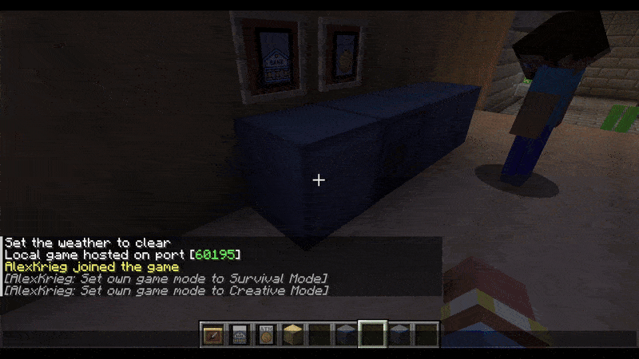
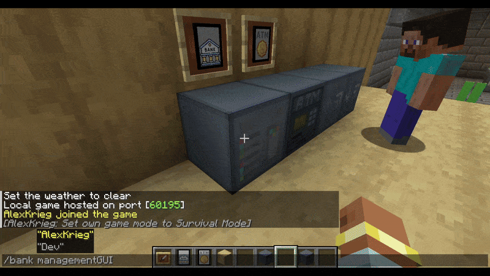

# Bank Accounts

## Personal Bank Account

Every player has one personal bank account that is created automatically. Personal bank accounts cannot be deleted.

## Creating a New Bank Account

<div align="center">
     
</div>

A player can create additional bank accounts using the command:

```
/bank create <accountname>
```

After the bank has been created, the management GUI opens automatically.

The server limits how many accounts each player can create (default **3**, set by the admin with `MAX_BANK_ACCOUNTS_PER_PLAYER`, see [Configuration](Configuration.md#player-section)). Your personal account and accounts you were only added to do not count, but [founding a company](Companies.md#founding-a-company) does, because it creates the company's bank account. At the limit you get *"You have reached your limit of 3 bank account(s). You cannot create another one."*


---
## Shared Bank Accounts

<div align="center">
     
</div>

A player can add other players to their bank account through the management GUI.
Open it using the command:

```
/bank manage
```

Permissions for each player can be configured individually:

- **Allowed to deposit**: The player can deposit items to the bank account.
- **Allowed to withdraw**: The player can use items from the bank account.
- **Allowed to manage**: The player can:
   - Add or remove other players.
   - Change permissions of other players.
   - Change the account name.
   - Change the account icon.
   - Delete the account.

> [!NOTE]
> Only manually created bank accounts can be deleted. The personal bank account cannot be deleted.

Changes to the account name, the user list and the permissions are stored when you press **Save changes**.
If you close the screen, or pick a different account with the account selection button, while there are unsaved changes, a popup asks whether to **Save** or **Discard** them. Press **Esc** on the popup to go back to the management screen without deciding.

The management screen also has these buttons:

- **Bindings** — link a slot to an external currency mod's account. Everyone on the account can open it; binding and unbinding need **Allowed to manage**. See [Currency Bindings](CurrencyBindings.md).
- **History** — the balance history chart of this account, the same as in the [Bank Terminal](Usage.md#balance-history-chart).
- **Payouts** — only for managers of accounts bound to a company: recurring wages and dividends. See [Companies](Companies.md#payouts-tab).

**Frozen accounts.** An admin can freeze an account. A frozen account shows a grey **Frozen** marker in the header. While it is frozen, nothing can be moved in or out by players: no deposits or withdrawals at the terminal, no bank notes, no converter, no Upload/Download blocks, no crafting with bank items, no money transfers to or from it, and no payouts or dividends paid from it. You get a chat message and keep your items. You can still see the account; ask an admin to unfreeze it.

**Untrusted servers.** On a [multi-server network](MultiserverSetup.md#what-an-untrusted-slave-can-do), if the server you play on is not yet trusted by the master, the management screen is read-only and says *"This server is not trusted by the master server. Changes are disabled until an admin runs /banksystem trust."*

---
## Selecting a Bank Account

When a player has access to multiple bank accounts (personal + shared), they can select which account to use. The Bank Terminal and other blocks operate on the currently selected account.

Use the command to manage a specific account:
```
/bank manage <accountname>
```
