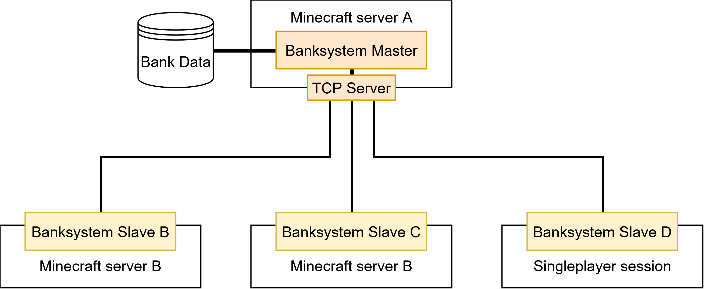

# Multi-Server Setup

BankSystem allows multiple Minecraft servers to connect and share the banking system, including bank accounts. When activated, it uses a master-slave architecture.

<div align="center">
     <br>
    <b>Master-Slave Architecture</b>
</div>

---
<table>
<tr>
<td>
<b>Master</b><br>
The master manages and stores the bank accounts of each player, including players that are online on the slave servers.
</td>
<td>
<b>Slave</b><br>
The slave server needs to be connected to a master in order to use the bank system. 
A slave always forwards bank system requests to the master for processing.
Bank accounts and balances are not stored on a slave. A slave only keeps its own <code>settings.json</code> and a diagnostics database (see <a href="#what-runs-where">What runs where</a>).
</td>
</tr>
</table>

---
## Setting Up a Master

Edit the configuration file at: `<ServerFolder>/config/modutilities/MultiServerConfig.json`

> An existing `config/MultiServerConfig.json` from an older version is moved to this location automatically on first start.

```json
{
  "enable": true,                       
  "isMaster": true,
  "sharedSecret": "change-me-please",
  "slaveID": "",
  "masterHost": "",
  "masterTcpPort": 25575
}
```

| Setting | Description |
|---------|-------------|
| `enable` | Enables/disables the multi-server feature. If disabled, the server manages bank accounts on its own and slaves cannot connect. |
| `isMaster` | Set to `true` for the master server. |
| `sharedSecret` | A shared string that slaves must match to connect. **Change this** to ensure only trusted slaves can connect. |
| `slaveID` | Ignored for a master. |
| `masterHost` | Ignored for a master. |
| `masterTcpPort` | The TCP port on which the master listens for slave connections. |

---
## Setting Up a Slave

Edit the configuration file at: `<ServerFolder>/config/modutilities/MultiServerConfig.json`

> An existing `config/MultiServerConfig.json` from an older version is moved to this location automatically on first start.

```json
{
  "enable": true,
  "isMaster": false,
  "sharedSecret": "change-me-please",
  "slaveID": "slave_server_1",
  "masterHost": "127.0.0.1",
  "masterTcpPort": 25575
}
```

| Setting | Description |
|---------|-------------|
| `enable` | Enables/disables the multi-server feature. |
| `isMaster` | Set to `false` for a slave server. |
| `sharedSecret` | Must match the master's `sharedSecret` to establish a connection. |
| `slaveID` | A unique identifier for this slave server. Each slave must have a different ID. |
| `masterHost` | The IP address or hostname of the master server. |
| `masterTcpPort` | The TCP port the master is listening on. |

---
## What Runs Where

| | Master | Slave |
|---|---|---|
| Bank accounts, balances, item registry | Stored and processed here | Asks the master |
| `settings.json` | Its own file; the **Mod Settings** screen edits this one | Its own file. The item component lists are overwritten by the master's values; the other values are read from the slave's own file. See [Configuration](Configuration.md#multi-server-behavior) |
| Transaction ledger, audit files, [suspicion flags](Administration.md#suspicious-activity-flags), daily digest | Written here, for every server of the network | Not written |
| [Discord feed](Configuration.md#discord-feed) | Posts every event once | Never posts |
| Chat alerts for admins | Sent | Sent to BankSystem admins online on the slave too |
| Diagnostics database (`banksystem_diagnostics.db`) | Note-flow log only | Note-flow log and the transfer journal (every transfer of value to or from the master) |

`/banksystem serverInfo` shows the role of the server you are on and, on a slave, whether the master trusts it.

---
## Trusted Slave Servers

By default, slave servers are **untrusted**. The master cannot check which player a request from a slave really comes from, so it treats an untrusted slave carefully: players there can still look at their own accounts, but almost everything else is refused (see the [table below](#what-an-untrusted-slave-can-do)).

To allow a slave server to perform all operations, it must be explicitly added to the trusted list on the master server.

### Adding a Trusted Slave

Run the following command **on the master server**:
```
/banksystem trust <slaveID>
```
The `slaveID` must match the `slaveID` value configured in the slave's `MultiServerConfig.json`. The command provides auto-suggestions for currently connected slave servers.

### Removing a Trusted Slave

```
/banksystem untrust <slaveID>
```

### Viewing Trust Status

BankSystem admins can see all connected servers and their trust status with:
```
/banksystem serverNetworkInfo
```
On a slave, `/banksystem serverInfo` shows whether this slave is trusted.

### What an Untrusted Slave Can Do

| Area | On an untrusted slave |
|---|---|
| Commands | Only `/money` and `/money circulation` work. Every other bank command (`/bank`, `/money send`, `/company`, the `/banksystem` admin commands, …) is refused. |
| Own accounts | Members can still read their accounts. |
| Deposits, withdrawals, transfers | Refused: terminal, ATM bank notes, converter deposits, Upload/Download blocks. Items stay with the player. |
| New items | Items the master has never seen cannot be registered from the slave; only items the master already knows can be banked. |
| Account management and Bindings screens | Read-only. The management screen shows *"This server is not trusted by the master server. Changes are disabled until an admin runs /banksystem trust."* |
| BankSystem admins | No admin mode in `/banksystem manage` and `/bank manage`; the audit screen shows *Access denied*; balance history of other accounts and of the whole server is not shown. |
| Bank displays | Show no data. |
| [Placeholders](Placeholders.md) | Placeholders with account data stay empty: the player's balances and account number, `rank`, the account and player counts and the richest-players list. |
| Server network overview | `/banksystem serverNetworkInfo` is refused. |
| LuckPerms admin-flag sync | Changes made on the slave are not passed to the master. |

> [!NOTE]
> Reading your own account still works on an untrusted slave. The master has to believe the slave about who the player is, so a slave owner who fakes a member's identity could read that member's accounts (but not change them). Only connect slaves you know, even untrusted ones.

### How It Works

The trusted slave list is stored as part of the world data and persists across server restarts. When a slave forwards a request to the master, the master checks:

1. **Is the function allowed for untrusted slaves?** Only the reads listed above are.
2. **If not, is the slave in the trusted list?** If yes, the request proceeds. If no, the request is rejected.

This two-tier security model means:
- **Untrusted slaves** let players look at their own accounts, nothing more.
- **Trusted slaves** can forward any operation, including deposits and withdrawals initiated by other mods (e.g. the StockMarket mod running on the slave).

> [!IMPORTANT]
> Only trust slave servers that you fully control. A compromised trusted slave could manipulate bank data (e.g. deposit items for free).

---
## Reliability: When the Master Does Not Answer

Every request from a slave to the master waits for an answer. A request **fails** when:

- the master does not answer within **30 seconds** (slow reads such as the audit screen, balance history and the network overview wait up to 150 seconds, because the master may be paused for a [backup](Administration.md#backups)),
- the connection to the master drops while the request is open, or
- the request cannot be sent at all.

A failed request does not always mean nothing happened: the master may have done the work and only the answer got lost. BankSystem is built for that case:

- **Each transfer is applied at most once.** Every transfer of money or items between a slave and the master carries an ID, and the master never applies the same ID twice.
- **Check before refund.** Before a slave gives anything back, it asks the master whether the transfer went through. Items or money come back only when the master confirms it did **not** apply the transfer.
- **Unknown stays unknown.** If even that check gets no answer, nothing is refunded and nothing is taken twice. The transfer is logged for an admin to sort out by hand: as *timed out* in the slave's transfer journal, and for bank notes paid out to a player on a slave (ATM withdrawals) also as a [**Transfer parked** flag (code 6)](Administration.md#suspicious-activity-flags) on the master.

What players see per block:

| Where | When the outcome is unknown |
|---|---|
| Bank Terminal deposit, Bank Upload Block | The items are taken out before the deposit is sent. They come back when the master confirms it did not take them; otherwise they stay out and the transfer is logged for an admin. |
| Bank Terminal withdrawal | Items put into the terminal are taken back out. Items the player already took out are not charged; their amount stays **locked** on the account. |
| Bank Download Block, crafting with bank items | The amount stays **locked** on the account. An admin decides whether to release it (see [Locked Amounts](Administration.md#locked-amounts)). |
| Commands (`/bank`, `/banksystem`, …) | Chat: *"Request to the master server failed or timed out; check the result before retrying."* |
| Bindings screen | *"Master server did not respond."* |
| Company payouts and dividends | *"No answer from the bank server. The payment may still have gone through; check the history before paying again."* |

> [!TIP]
> When a player reports a lost transfer, check the account in `/banksystem audit` on the master first. If the ledger shows the transfer, it went through. The slave's diagnostics database (`TransferJournal` table) shows every step of each transfer with its ID.

---
## Troubleshooting

| Symptom | Cause and fix |
|---|---|
| Slave log: *"Slave has been waiting more than 30 seconds for SyncItemIDsPacket from master"* | The slave has not reached the master since it started. Until it does, new items cannot be registered on the slave. Check that the master runs, that `masterHost` and `masterTcpPort` are right, that the port is open, and that `sharedSecret` is the same on both servers. The warning appears once per start. |
| Every bank action on the slave is refused, players see their accounts read-only | The slave is not trusted. Run `/banksystem trust <slaveID>` on the master. `/banksystem serverInfo` on the slave shows the trust status. |
| Placeholders such as the balance, `rank` or the richest-players list are empty on one server | That slave is not trusted. |
| *"Request to the master server failed or timed out"* | The master was slow, restarting or unreachable. Check the result (`/bank`, the audit screen) before retrying, so nothing is done twice. |
| An amount stays locked after a failed transfer | See [Locked Amounts](Administration.md#locked-amounts) before you unlock it. |
| Currency bindings | Bindings live on the master like every account. The currency mod must be installed on the master; see [Currency Bindings](CurrencyBindings.md). |
